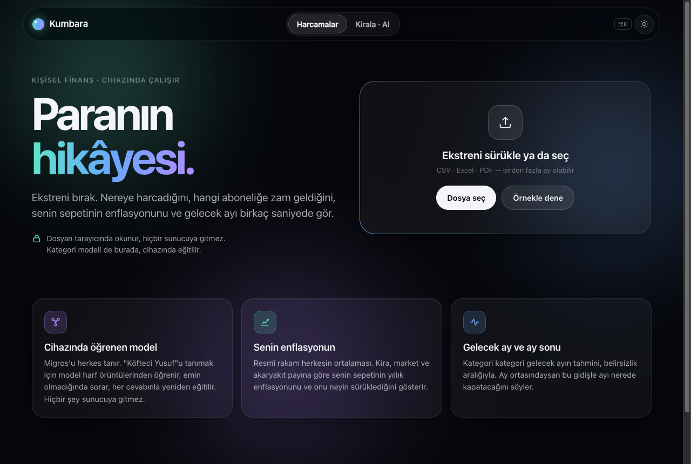
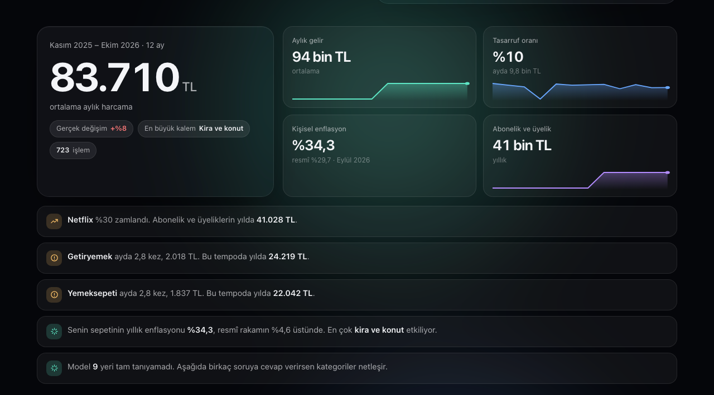
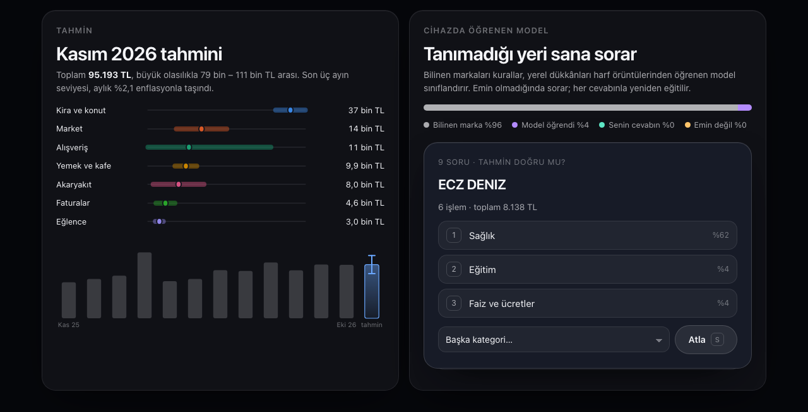
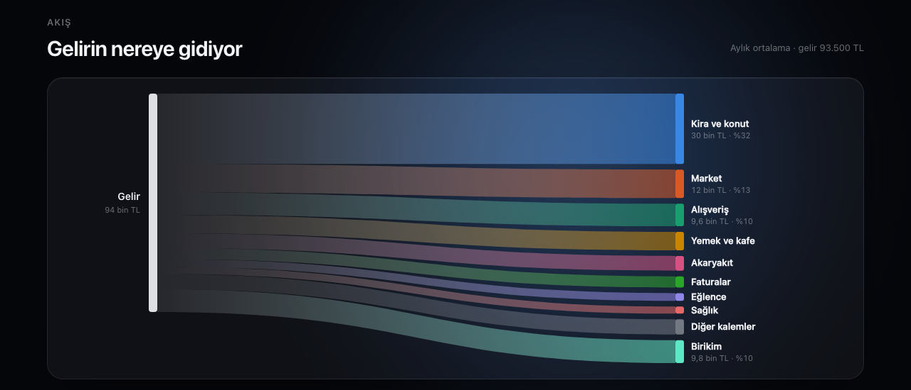

# Kumbara

[](https://github.com/emrtunali/kumbara/actions/workflows/ci.yml)
[](https://emrtunali.github.io/kumbara/)
[](LICENSE)

Banka ekstreni tarayıcıya bırakıyorsun. Kumbara sana şunları gösteriyor:

- paranın nereye gittiğini;
- hangi aboneliğe zam geldiğini;
- kendi harcama sepetinin enflasyonunu;
- gelecek ay ne kadar harcayacağını.

Hepsi senin cihazında hesaplanıyor. Sunucu yok, hesap yok, takip yok.

**[Siteyi aç](https://emrtunali.github.io/kumbara/)** · [örnek ekstreyle aç](https://emrtunali.github.io/kumbara/?ornek) · [English](#english)



## Neden bir tane daha harcama uygulaması?

Çoğu uygulama bankana bağlanmak ister, verini sunucusuna taşır ve tanımadığı her dükkânı "Diğer"e atar. Kumbara üç şeyi farklı yapıyor.

**1. Kategorileri cihazında öğrenen bir model.** Migros'u, Netflix'i, Enerjisa'yı herkes tanır. "KÖFTECİ YUSUF", "ECZ. DENİZ", "BALIKÇI ALİ USTA" gibi mahalle dükkânlarını ise kurallar tanımaz. Kumbara bunlar için tarayıcıda bir sınıflandırıcı eğitiyor. Sınıflandırıcı kelimelerden ve 3–5 harflik parçalardan öğreniyor. Böylece "köfteci", "köftecisi" ve "kofte" aynı ipucunu paylaşıyor, "ECZ" kısaltması bile eczaneyi gösteriyor. Emin olmadığı dükkânı sana soruyor. Cevap verdiğin anda yeniden eğitiliyor ve benzer isimleri de düzeltiyor.

**2. Senin enflasyonun.** Resmî enflasyon herkesin ortalaması. Kira artışı %41, akaryakıt %54, giyim %13 iken kirada oturan biriyle ev sahibinin enflasyonu aynı olamaz. Kumbara her kategorinin resmî fiyat endeksini kendi harcama payınla ağırlıklandırıyor. Ortaya senin sepetinin yıllık enflasyonu ve onu en çok neyin sürüklediği çıkıyor.

**3. Gelecek ay ve ay sonu.** Kategori kategori gelecek ayın tahmini, belirsizlik aralığıyla birlikte. Ay ortasındaysan, şu ana kadarki harcamandan ayı nerede kapatacağını da hesaplıyor.



## Modelin başarısı

Ölçüm, eğitimde hiç kullanılmayan 121 satırlık bir test setinde yapıldı: elle yazılmış, çoğu küçük yerel işletme ([`tests/fixtures/unseen-merchants.json`](tests/fixtures/unseen-merchants.json)).

| | Doğru kategori |
|---|---|
| Yalnızca marka kuralları | %14 |
| Kurallar + cihazda öğrenen model | **%79** |
| Modelin karar verdiği satırlarda isabet | **%97** (satırların %82'si) |
| Doğru cevabın sorulan üç seçenekte olması | **%99** |

Model emin olmadığında tahmin etmiyor, soruyor. Sorduğunda da doğru cevap neredeyse her zaman gösterdiği üç seçenekten biri, yani tek dokunuşla düzeliyor. Bu set elle yazıldı ve küçük. Rakamlar bir gösterge, genel bir garanti değil.



## Neler var

- **Tasarruf planlayıcı:** bir hedef ve süre koyuyorsun. Kategori kaydırıcılarıyla ("paket servisi %40 azalt") ve abonelik iptalleriyle hedefe kaç ayda ulaşacağını anında görüyorsun. Birikimin mevduatta faiz kazanması ve hedefin enflasyonla büyümesi de hesapta.
- **Uyarılar:** aynı yere birkaç gün arayla aynı tutarın iki kez çekilmesi (çift çekim) ve son aylarda sessizce başlayan düzenli ödemeler (unutulmuş deneme süreleri).
- **Para akışı:** gelirin kategorilere ve birikime nasıl dağıldığını gösteren akış (Sankey) diyagramı.
- **Kategoriler:** halka grafik ve liste. Bir kategoriye dokununca işlemler süzülüyor.
- **Abonelik ve zam dedektörü:** her ay benzer tutarda çekilen ödemeleri yıllık maliyetiyle gösteriyor, zamları işaretliyor.
- **Bugünün fiyatıyla harcama:** ay ay harcamayı enflasyondan arındırıyor. Gerçekten daha mı çok harcıyorsun, yoksa yalnızca fiyatlar mı arttı?
- **Sızıntılar:** paket servis ve kahve gibi sık küçük harcamaların yıllık temposu.
- **Her bankanın dosyası:**
  - CSV (`;`, `,` ya da sekme), Excel ve PDF;
  - başlık satırını ve sütunları kendisi buluyor;
  - "1.234,56", "-1.234,56 TL" ve "123,45-" gibi yazımları okuyor;
  - ayrı Borç/Alacak sütunlarını tanıyor;
  - hesap hareketiyle kart ekstresini ayırt ediyor;
  - Windows-1254 kodlu dosyaları okuyor.
- **Birden fazla ay:** dosyaları birlikte yükleyebilirsin. Çakışan günler iki kez sayılmıyor, aynı gün iki kahve ise iki kahve olarak kalıyor.
- **Klavye:** `⌘K` işlemlerde arama, soru kartında `1` `2` `3` ile cevap, `S` ile geç.
- **Uygulama gibi:** telefona ya da bilgisayara uygulama olarak eklenebiliyor ve internet yokken de açılıyor. Ekstreler önbelleğe hiç girmiyor.



## Kirala mı, satın al mı?

Aynı aylık bütçeye sahip iki hane karşılaştırılıyor:

- **Ev alan:** peşinatı, tapu harcını ve kredi masraflarını öder. Sonra sabit faizli taksit, bakım, emlak vergisi ve sigorta öder.
- **Kirada kalan:** peşinatı yatırır, kira öder.
- **Her ay:** kim daha az ödüyorsa aradaki farkı yatırır.
- **Sonunda:** ev satılır, iki servet bugünün parasıyla karşılaştırılır.

Gelecekler Türkiye'nin 2010'dan bu yana aylık enflasyon, kira, konut fiyatı, dolar ve faiz geçmişinden üretiliyor. Veri 12 aylık bloklar hâlinde birlikte örnekleniyor (block bootstrap). Böylece bu değişkenler arasındaki gerçek ilişki korunuyor.

Simülatör şunları gösteriyor:
- ev almanın kazandığı senaryoların oranı;
- medyan fark ve %80 aralık;
- ev almanın öne geçtiği yıl;
- yıllara göre servet bantları;
- sonucu en çok hangi varsayımın değiştirdiği.

Ekstren yüklüyse, kredi taksidinin bugünkü kira ve birikimine sığıp sığmadığını da söylüyor.


Bir uyarı: 2010–2026 arasında TL mevduatın enflasyon ve stopaj sonrası getirisi çoğu yıl negatifti, konut ise enflasyonu yendi. Bu yüzden geçmişten üretilen gelecekler ev almaya yatkın çıkıyor. "Kendi varsayımlarım" ve stres testiyle başka bir dünya deneyebilirsin. Yatırım tavsiyesi değildir.

## Gizlilik

- **Okuma:** ekstre `FileReader` ile okunuyor, hiçbir yere gönderilmiyor.
- **Ağ erişimi:** içerik güvenlik politikası (CSP) sayfanın kendi sunucusu ve cdnjs dışında hiçbir adrese bağlanmasına izin vermiyor. cdnjs yalnızca Excel ve PDF okuyucu kütüphaneler için, sadece o dosya türü seçildiğinde kullanılıyor.
- **Analitik:** yok, çerez yok.
- **Kayıt:** tarayıcında yalnızca kategori düzeltmelerin ve tema tercihin saklanıyor.

## Veri

| Seri | Kaynak | FRED kodu |
|---|---|---|
| Tüketici fiyatları ve 12 harcama kategorisi (uyumlaştırılmış TÜFE) | Eurostat | `CP0000TRM086NEST`, `CP0100…`, `CP1100…` |
| Konut kirası endeksi | Eurostat | `CP0410TRM086NEST` |
| Konut fiyat endeksi | BIS | `QTRN628BIS` |
| Bankalararası gecelik faiz | OECD | `IRSTCI01TRM156N` |
| USD/TRY | OECD | `CCUSMA02TRM618N` |

Veriler [FRED](https://fred.stlouisfed.org) üzerinden, anahtarsız çekiliyor (`scripts/fetch_macro.py`). GitHub Actions bunları her ay yeniliyor.

## Geliştirme

```bash
npm test          # 27 test, Node'un kendi test aracı, bağımlılık yok
npm run serve     # http://localhost:8792
npm run data      # makro veriyi yenile
npm run demo      # örnek ekstreleri yeniden üret
```

Derleme adımı ve npm bağımlılığı yok. Kod düz ES modülleri, tarayıcıda olduğu gibi çalışıyor.

```
site/js/
  parse.js        CSV, Excel ve PDF satırlarını işlemlere çeviriyor
  categorize.js   marka kuralları
  learn.js        cihazda eğitilen naive Bayes sınıflandırıcı, soru sırası
  insight.js      kişisel enflasyon, gelecek ay ve ay sonu tahmini
  plan.js         tasarruf planlayıcı, çift çekim ve yeni abonelik uyarıları
  analysis.js     aylık kırılım, abonelikler, sızıntılar
  simulate.js     kirala mı al mı Monte Carlo
  charts.js       bağımlılıksız SVG grafikler (akış, halka, bantlar)
  app.js, sim.js  arayüz
site/sw.js        çevrimdışı çalışma (ekstreler önbelleğe girmez)
```

## English

**Kumbara** is a private, on-device personal finance tool for Türkiye.

- **Statements:** reads bank and card statements (CSV, Excel, PDF) in the formats Turkish banks use.
- **Categories:** a naive Bayes classifier is trained in the browser on word and character n-gram features, so it can categorise local merchants that brand rules miss. On 121 held-out merchant lines it raises accuracy from 14 % (rules alone) to 79 %, with 97 % precision where it commits. When it is unsure, it asks, and it retrains on every answer.
- **Personal inflation:** weights Eurostat's category price indices for Türkiye by your own spending shares.
- **Forecast:** next month's spending, with ranges.
- **Planner and alerts:** a savings goal with category cuts and cancellable subscriptions; double charges and quietly started subscriptions are flagged.
- **Rent or buy:** a Monte Carlo comparison, block-bootstrapped from Turkish macro history.
- **Installable and offline:** works as an app without a connection; statements are never cached.

Nothing leaves your device. MIT licensed.

## Lisans

[MIT](LICENSE) © 2026 Emir Tunali
