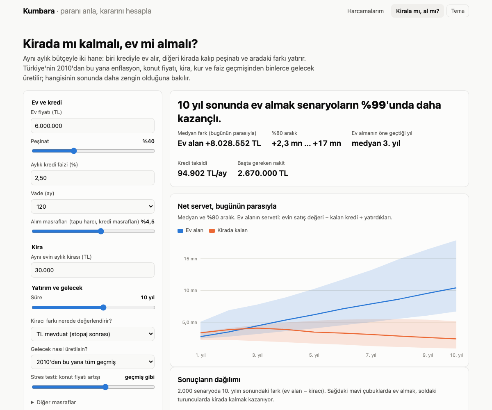

# Kumbara

[](https://github.com/emrtunali/kumbara/actions/workflows/ci.yml)
[](https://emrtunali.github.io/kumbara/)
[](LICENSE)

**Paranı anla, kararını hesapla.** Banka ekstreni yükle, paranın nereye gittiğini, hangi aboneliğe zam geldiğini ve harcamanın enflasyondan arındırılmış gerçek değişimini gör. Sonra "kirada mı kalmalıyım, ev mi almalıyım?" sorusunu Türkiye'nin kendi geçmiş verisiyle, binlerce senaryoda hesapla.

**Verin cihazından çıkmaz.** Kumbara tamamen tarayıcıda çalışan statik bir sayfa: sunucu yok, hesap yok, analitik yok. Dosyan tarayıcında okunur ve hiçbir yere gönderilmez.

**[Siteyi aç →](https://emrtunali.github.io/kumbara/)** · [Örnek ekstreyle dene](https://emrtunali.github.io/kumbara/?ornek) · [English](#english)


## Harcamalarım: ekstre analizi

- **Her bankanın dosyası:** CSV (`;`, `,` ya da sekme), Excel (.xlsx, .xls) ve PDF ekstreler.
  - Başlık satırı, tarih, açıklama ve tutar sütunları kendiliğinden bulunur. Ayrı Borç ve Alacak sütunları da tanınır.
  - Tutarlar "1.234,56", "-1.234,56 TL", "123,45-" gibi yazılsa da okunur.
  - Hesap hareketi (harcama eksi) ile kredi kartı ekstresi (harcama artı) ayrımı otomatik yapılır.
  - Türk bankalarının Windows-1254 kodlu CSV'leri de okunur.
  - Olmazsa sütunları elle seçebilirsin.
- **Türkçe kategoriler:** Migros, A101, BİM, Yemeksepeti, Getir, Trendyol, Enerjisa, İGDAŞ, Turkcell, İstanbulkart, Shell gibi yüzlerce marka 17 kategoriye ayrılır. Yanlışı düzeltirsen aynı yerdeki bütün işlemler güncellenir ve düzeltme bu tarayıcıda hatırlanır.
- **Abonelik ve zam dedektörü:** her ay benzer tutarda çekilen ödemeleri bulur, yıllık maliyetini ve zam oranını gösterir ("Netflix %30 zamlandı").
- **Enflasyondan arındırılmış harcama:** aylık harcamalarını son ayın fiyatlarına çevirir. Gerçekten daha mı çok harcıyorsun, yoksa yalnızca fiyatlar mı arttı?
- **Sızıntılar ve sıra dışı harcamalar:** kahve ve paket servis gibi sık küçük harcamaların yıllık temposu, kategorisinin olağanın çok üstündeki harcamalar.
- **Birden fazla ay:** dosyaları birlikte yükle. Çakışan günler iki kez sayılmaz, aynı gün iki kahve ise iki kahve olarak kalır.

## Kirala mı, al mı? Monte Carlo simülatörü



Aynı aylık bütçeye sahip iki hane karşılaştırılır:

- **Ev alan:** peşinatı ve alım masraflarını (tapu harcı, kredi masrafları) öder. Sonra sabit faizli kredi taksidi, bakım, emlak vergisi ve sigorta öder.
- **Kirada kalan:** peşinatı ve alım masraflarını yatırır, kira öder.
- **Aradaki fark:** her ay hangisi daha az ödüyorsa fark onun yatırımına gider; ikisi de tam olarak aynı parayı harcar.
- **Süre sonunda:** ev satılır (satış masrafı ve kalan kredi düşülür), iki servet **bugünün parasıyla** karşılaştırılır.

**Gelecekler Türkiye'nin kendi geçmişinden üretilir.** 2010'dan bu yana her ayın enflasyonu, kira artışı, konut fiyat değişimi, dolar kuru ve faizi birlikte 12 aylık bloklar hâlinde örneklenir (block bootstrap). Böylece aralarındaki ilişki korunur: yüksek enflasyonla yüksek faiz, konut fiyatının ardından kiranın gelmesi. Sonuçlar:

- ev almanın kazandığı senaryoların oranı;
- medyan fark ve %80 aralık;
- ev almanın öne geçtiği yıl;
- yıllara göre net servet bantları;
- sonuçların dağılımı;
- ilk ay nakit akışı ve toplam faiz;
- sonucu en çok değiştiren varsayımlar (tornado grafiği);
- ekstreden gelen kira ve birikimle "bu taksit bütçene sığar mı?" kontrolü.

"Son 5 yıl", "kendi varsayımlarım" ve konut fiyatı stres testiyle farklı dünyaları deneyebilirsin.

**Dürüst bir uyarı:** 2010–2026 Türkiye'sinde TL mevduatın enflasyon ve stopaj sonrası getirisi çoğu yıl negatifti, konut ise enflasyonu yendi. Geçmişten üretilen gelecekler bu yüzden ev almaya yatkın çıkar. Geçmiş geleceğin garantisi değildir. Yatırım tavsiyesi değildir.

## Veri

`site/data/macro.json` dosyası `scripts/fetch_macro.py` ile [FRED](https://fred.stlouisfed.org) üzerinden (anahtarsız) çekilir ve her ay GitHub Actions ile yenilenir:

| Seri | Kaynak | FRED kodu |
|---|---|---|
| Tüketici fiyatları (uyumlaştırılmış TÜFE) | Eurostat | `CP0000TRM086NEST` |
| Konut kirası endeksi | Eurostat | `CP0410TRM086NEST` |
| Konut fiyat endeksi (nominal, çeyreklik) | BIS | `QTRN628BIS` |
| Bankalararası gecelik faiz | OECD | `IRSTCI01TRM156N` |
| USD/TRY | OECD | `CCUSMA02TRM618N` |

## Geliştirme

```bash
npm test                    # Node'un kendi test aracı, bağımlılık yok
npm run serve               # http://localhost:8792
npm run data                # makro veriyi FRED'den yenile
npm run demo                # örnek ekstreleri yeniden üret
```

Derleme adımı ve npm bağımlılığı yok. Kod düz ES modülleri ve tarayıcıda olduğu gibi çalışıyor. Excel ve PDF okumak için SheetJS ile pdf.js yalnızca gerektiğinde cdnjs'ten yüklenir. İçerik güvenlik politikası (CSP) sayfanın başka hiçbir adrese bağlanmasına izin vermez.

```
site/js/
  parse.js       CSV/Excel/PDF satırlarını işlemlere çevirir (tutar, tarih, sütun tespiti)
  categorize.js  Türkçe marka kuralları, kullanıcı düzeltmeleri
  analysis.js    aylık kırılım, enflasyon arındırma, abonelikler, sızıntılar
  simulate.js    kirala mı al mı Monte Carlo (block bootstrap)
  charts.js      bağımlılıksız SVG grafikler
  app.js, sim.js sayfa
```

## English

**Kumbara** ("piggy bank") is a privacy-first personal finance tool for Türkiye that runs entirely in the browser.

- **Statement analysis:** reads bank and card statements (CSV, Excel, PDF) in the formats Turkish banks use. It categorises spending by Turkish merchant names, finds subscriptions and their price rises, and shows spending in inflation-adjusted lira.
- **Rent-or-buy simulator:** a Monte Carlo comparison of buying with a fixed-rate mortgage versus renting and investing the difference. Futures are block-bootstrapped from Türkiye's own 2010–2026 history of inflation, rents, house prices, interest rates and the lira.

No server, no account, no analytics: statements never leave your device. Code: MIT.
